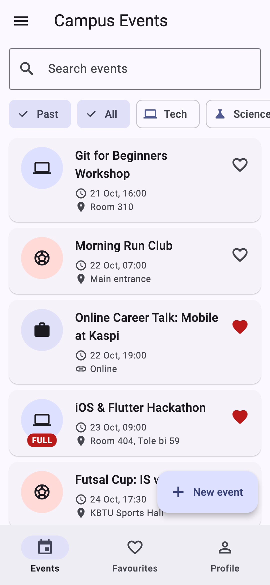
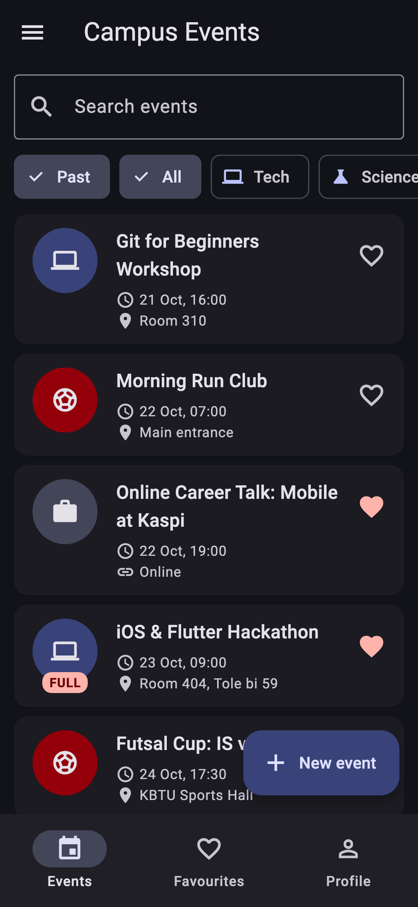
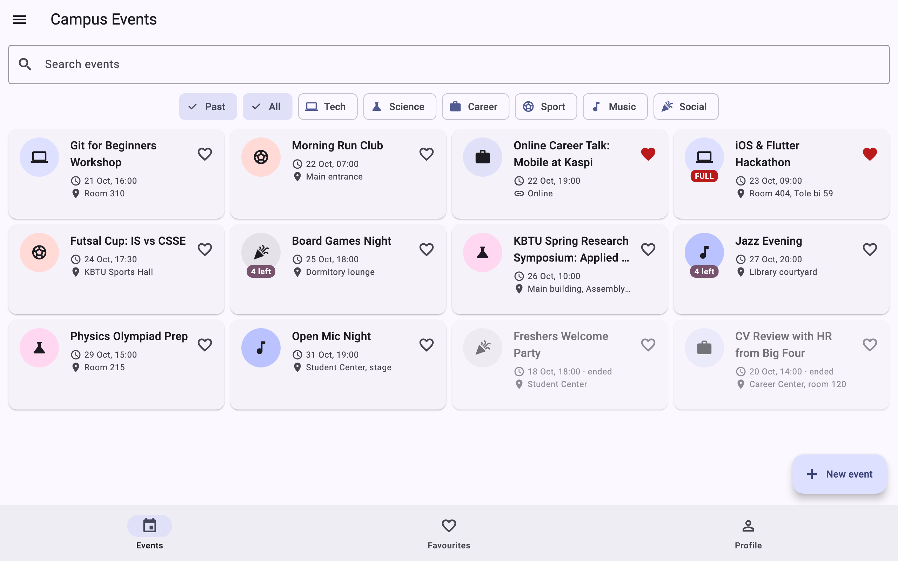

# Campus Events

Lab 1 "Your App", Mobile Development, KBTU. Nurassyl Turarbek.

**Domain: campus events.** Students browse what is happening at the university this week, register with one tap and organise their own events. Each event has a title, a category (Tech, Science, Career, Sport, Music, Social), a start time, a place, a capacity and the list of attendees. An **online** event's place is a meeting link instead of a room. All data lives in memory; *Reset data* in the drawer brings back the twelve seed events.

| Model part | In this app |
|---|---|
| title (3–60) | `Event.title` |
| category (enum: label + icon) | `EventCategory` |
| when | `Event.starts` (each event lasts 2 h) |
| limit | `Event.capacity` |
| the list | `Event.attendees` |
| mode | `Event.isOnline` → `location` must contain `://` |
| optional text | `Event.description` (`String?`) |
| favourite | `Event.isFavourite` |

Seed events that the defence looks at: **e1** has a 60-character title, **e2** (Hackathon) is full, **e3** (Freshers Party) is in the past, **e4** (Career Talk) is online, and **e5** (Futsal Cup) has no description.

## Screenshots

| Phone, light | Phone, dark | Tablet, grid |
|---|---|---|
|  |  |  |

## Structure

```
lib/
  main.dart              MyApp: ThemeMode state, themes, routes
  routes.dart            Routes names, DetailArgs/FormArgs, onGenerateRoute, Not found
  models/                Event, EventCategory, Profile, Countdown (sealed)
  data/seed.dart         twelve events relative to today
  utils/format.dart      18 Oct, 10:00 (no packages)
  screens/               home_shell, events_tab, favourites_tab, profile_tab,
                         detail_screen, event_form_screen
  widgets/               event_card, event_avatar, event_collection (list/grid),
                         empty_state, icon_tile
```

## Decisions

The list of events and the profile live in the shell's `State` (`HomeShell`). The tabs get them as constructor parameters and send every change back up through callbacks, so there is only one source of truth. The theme mode sits one level higher, in `MyApp`, because only `MaterialApp` can switch between `theme` and `darkTheme`. The detail screen receives the event and callbacks through `DetailArgs`: it changes the shell's data while it stays open (register, edit, delete), and a single value returned on pop could not do that. The form, by contrast, only produces one result, so it returns the saved `Event` through `Navigator.pop`, and the caller awaits it, checks for `null` and `mounted`, and only then calls `setState`. The grid is decided by `LayoutBuilder` rather than `MediaQuery` because it reacts to the width the list actually gets (split screen, a side panel), not to the whole screen. The form's `PopScope` compares a record of the current field values with the record captured in `initState`; records compare by value, so "dirty" is one `!=`. With week 9's tools I would move the events out of the shell into a shared state object (a `ChangeNotifier` or similar), so the detail screen could listen to it instead of keeping its own copy, and I would save the data to storage so it survives a restart.

## Run

```
flutter pub get
flutter run
```

`flutter analyze` reports no issues, and `dart format .` produces no diff.
