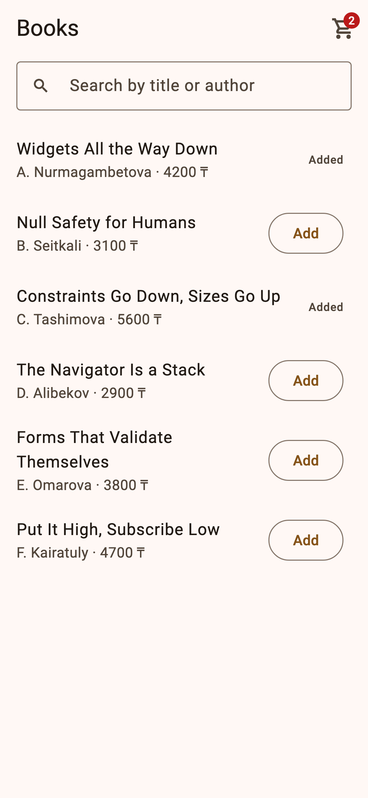
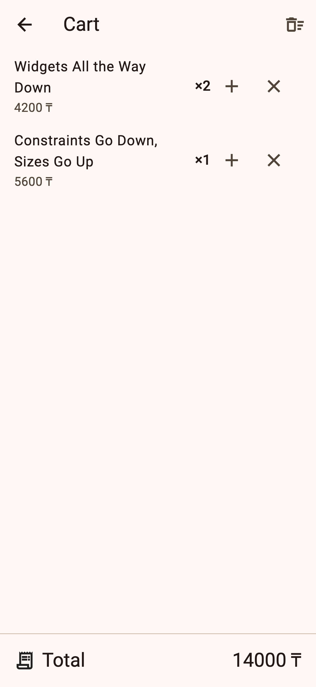

# shop — Practice 9: Put It High, Subscribe Low

A Books screen with Add buttons, a cart badge, and a Cart screen on a second route, built twice:

1. **lifted**: the cart is a `List` in a `StatefulWidget` above `MaterialApp`, passed down by hand (commit `lifted`).
2. **provided**: `Cart extends ChangeNotifier` (`lib/models/cart.dart`) is put in the tree once with
   `ChangeNotifierProvider` and reached with `watch` / `read` / `select` / `Consumer`.

Measurements, provider error texts and *Where does it live?* are in [NOTES.md](NOTES.md).

| Books (two added, badge 2) | Cart (quantity 2, total) |
|---|---|
|  |  |
