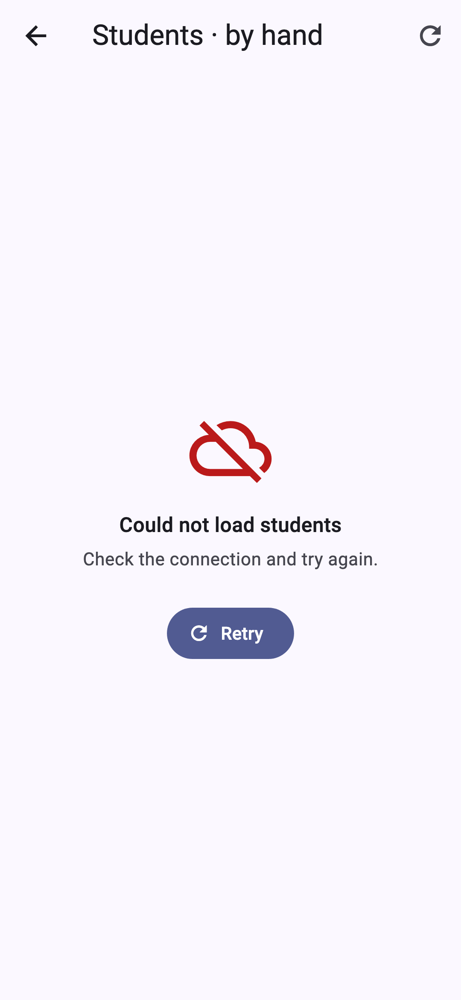
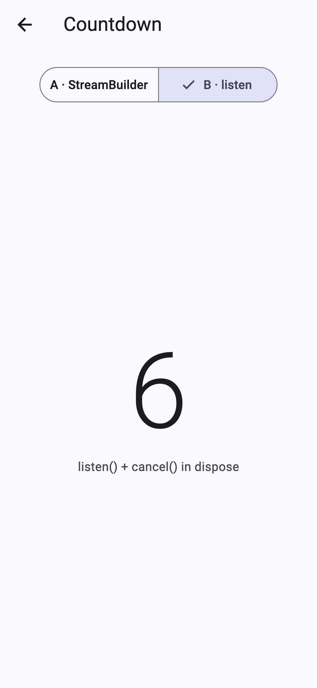

# students_async — Practice 10: The Data Arrives Later

A Students screen built around an API that does not exist yet: `FakeApi` (`lib/api/fake_api.dart`) takes two seconds
and fails every third call. The home screen has three ways in:

- **By hand**: three fields (`_students`, `_error`, `_api`), `try / catch`, `mounted` after every `await`, and the four
  views from `lib/widgets/` (loading, error with Retry, empty, list). The Save FAB is awaited, catches `StateError`,
  pops only on success and is disabled while in flight.
- **FutureBuilder**: the Future is a field set in `initState`. `hasError` is checked first, then `data ?? []`.
  The *Compact* switch rebuilds the screen without a new request.
- **Countdown**: `countdown(10)` is an `async*` stream. Version A uses `StreamBuilder`, and version B uses `listen` plus
  `cancel()` in `dispose`.

Console measurements, error texts and decisions are in [NOTES.md](NOTES.md).

| Error view with Retry | Countdown, version B mid-count |
|---|---|
|  |  |
